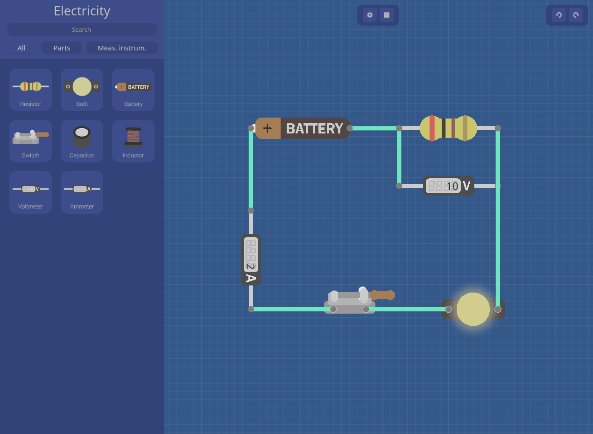
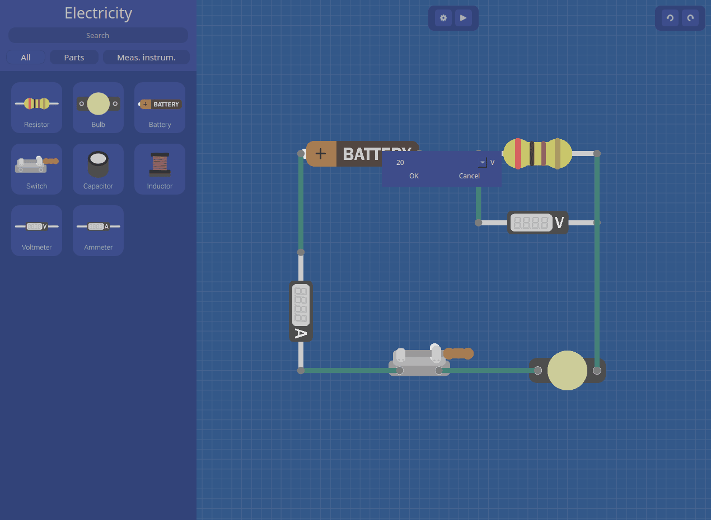
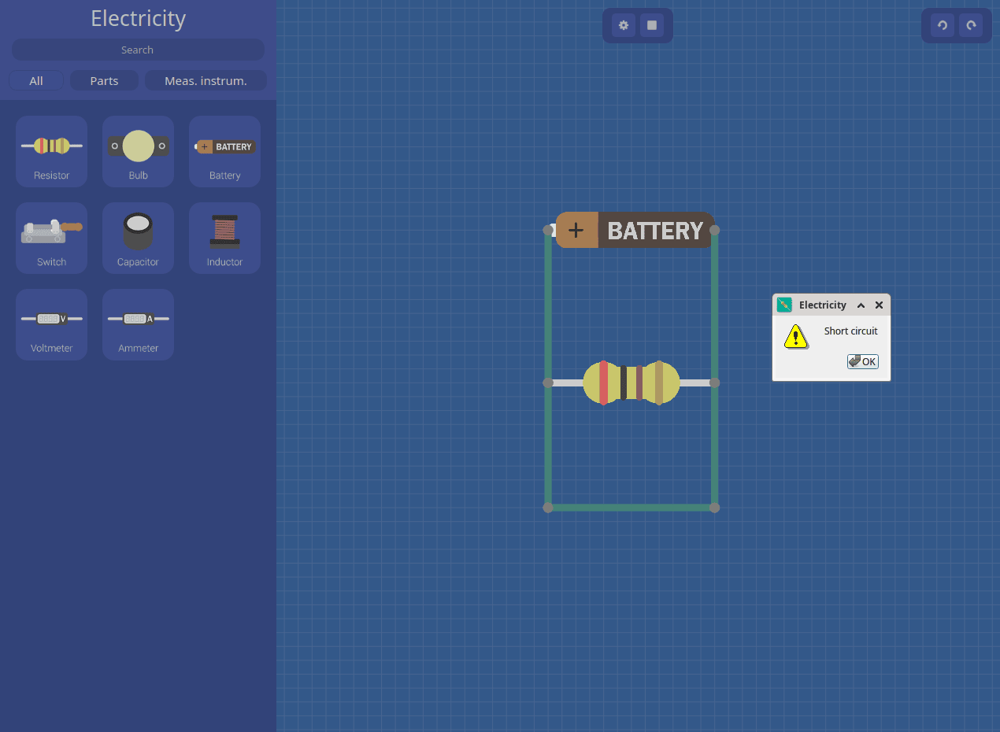
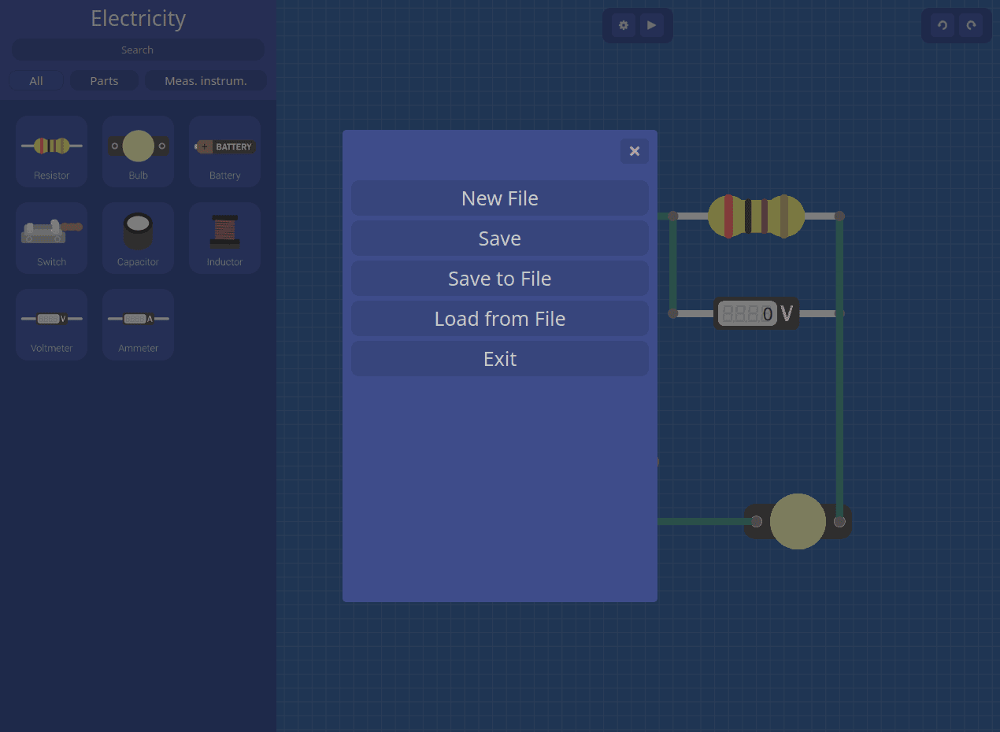

# Electricity

A 2017 school team project: an electric circuit simulator in Qt 5 / C++.
Place components on a grid, wire them, and solve the currents with
Kirchhoff's laws (Eigen + Boost.Multiprecision).


This is a reconstruction. The 2017 code split into two branches that
were never joined, and the final version is lost. `master` merges them
and fixes what kept the result from working.

## Build

Linux, Qt 5.15, Eigen 3, Boost headers. With Nix, `shell.nix` has all
of them:

```sh
git clone https://github.com/keyclicker/electricity-ui.git
nix-shell electricity-ui/shell.nix

mkdir build-electricity && cd build-electricity
qmake ../electricity-ui/Final.pro
make -j"$(nproc)"
./Final
```

Without Nix (untested): install Qt 5 (`qmake`), `pkg-config`, Eigen 3
(found via `pkg-config eigen3`) and Boost from your distro. Other
locations: `qmake EIGEN_DIR=/path/to/eigen3 BOOST_DIR=/path/to/boost`.

## Use

Elements are large at 1:1: zoom out with the mouse wheel first.

- Element: click it in the sidebar, click on the canvas to drop it.
  Click it again to carry it, right-click while carrying to rotate.
- Wire: right-click a pin, click where the wire ends (another pin or
  an empty spot, then continue from there). Drag wire ends to adjust.
- Value: right-click an element (a switch toggles).
- Delete: click an element or wire, press Delete.
- `▶` (or `R`): solve. Meters show readings, bulbs light up, wires
  carrying current glow, hover an element for its current. `■` stops.
- Toolbar: undo, redo. Settings button: New, Save, Load, Exit.
- Middle-drag pans, Esc hides the sidebar, F11 is fullscreen.

## Meter reader (`tk/`)

A separate Tkinter + OpenCV app: it reads an analog meter's needle
through a webcam and plots it over time, or shows the live value.
Python 3; `shell.nix` has its packages too.

```sh
python3 tk/tkinter_program.py            # webcam 1, else 0
python3 tk/tkinter_program.py 2          # webcam 2
python3 tk/tkinter_program.py meter.mp4  # a video, played like a webcam
```

Set the full-scale value and unit, pick the scale type (only the two
left ones read values), press Start. Drag a box around the meter while
the needle rests at 0: that frame is the reference. Space resets the
box.

Without Nix: Tkinter, OpenCV with a GUI backend (`opencv-python`, not
`-headless`), Pillow, NumPy.

## Screenshots

| Solved circuit | Input window |
| --- | --- |
|  |  |
| **Short circuit** | **Settings menu** |
|  |  |

## Layout

- `Final.pro`, `deps.pri`: the qmake project and its Eigen/Boost setup
- `main.cpp`, `source/`, `include/`: the app
  - `MainWindow`, `Canvas`, `GObject`, `Line`, `Point`, `InputWindow`:
    UI
  - `Resistor`, `Bulb`, ... (`EObject`): circuit elements
  - `Solver`, `Scheme`, `Graph`, `ComputeCycles`: the solver
- `forms/`, `icons/`, `resource.qrc`: UI form and images
- `test/`: Boost.Test projects; written for the older console solver,
  they don't build against this code
- `tk/`: the meter reader (`tk/tkinter_program.py`), ported from
  the 2017 Python 2

## History

The raw 2017 snapshots are kept as
[tags](https://github.com/keyclicker/electricity-ui/tags), one orphan
commit each; each tag message describes its snapshot. `master` starts
from `qt-2017-11-15.2` (logic branch: save/load, undo/redo), adds `tk/`
from `tk-2017-11-14` (tag `v0-original`), and merges `qt-2017-11-15.4`
(UI branch: polished UI).

## License

GPL-2.0-only: see [`LICENSE`](LICENSE).
